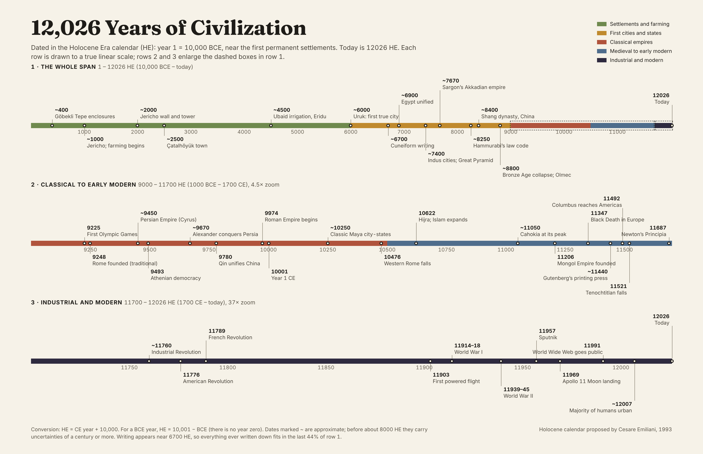

# Holocene: 12,026 years of civilization

A timeline of human civilization dated in the **Holocene Era (HE)** calendar, where year 1 falls near the first permanent human settlements and the current year is **12026 HE**.

The project has two parts:

- **An interactive explorer** ([`index.html`](index.html)): a pan-and-zoom timeline drawn to a true linear scale, with event details, an HE ↔ BCE/CE toggle and a year converter.
- **A printable poster** ([`poster/`](poster/)): a 17 × 11 in (tabloid, landscape) chart that shows the whole span plus two enlarged sections.

## Why a different year count?

The Gregorian calendar (BCE/CE) splits human history at an arbitrary point roughly two-thirds of the way along. Anything before it is counted backward, so comparing two ancient dates means subtracting in reverse, and there is no year zero to anchor the arithmetic.

The Holocene calendar adds 10,000 to every CE year. Its year 1 is 10,000 BCE, which sits near the start of the Holocene, the geological epoch that began as the last ice age ended. That moment also lines up roughly with the first permanent settlements and the beginnings of farming. The result is a single, ascending count that covers all of recorded and most of pre-recorded civilization with positive numbers.

Geologist Cesare Emiliani proposed the calendar in 1993.

### Converting dates

| From | To HE | Example |
| --- | --- | --- |
| CE year | HE = CE + 10,000 | 1969 CE → 11969 HE |
| BCE year | HE = 10,001 − BCE | 3100 BCE → 6901 HE |

The BCE rule uses 10,001 rather than 10,000 because the Gregorian calendar has no year zero: 1 BCE is followed directly by 1 CE (10001 HE).

### A note on "first cities"

Year 1 HE marks the era of the first *settlements*, not the first *cities*. Sites near year 1 include Göbekli Tepe, monumental stone enclosures built by hunter-gatherers (~400 HE), and Jericho (~1000 HE). True cities, meaning dense populations with specialized labor and administration, appear around 6000 HE, with Uruk in southern Mesopotamia as the usual first example. On this scale, cities occupy only the second half of the timeline. Writing (cuneiform, ~6700 HE) covers only the last ~44%.

## What's on the timeline

Events are grouped into five broad periods:

| Period | HE range | Examples |
| --- | --- | --- |
| Settlements and farming | 1 – 6000 | Göbekli Tepe, Jericho, Çatalhöyük, irrigation in Mesopotamia |
| First cities and states | 6000 – 9000 | Uruk, cuneiform, unified Egypt, Indus cities, Hammurabi, Shang China |
| Classical empires | 9000 – 10500 | Persia, Athens, Qin China, Rome, Classic Maya |
| Medieval to early modern | 10500 – 11700 | The Hijra, Cahokia, the Mongols, the printing press, Newton |
| Industrial and modern | 11700 – 12026 | Industrial Revolution, powered flight, Apollo 11, the Web |

These period boundaries are conventions for organizing the timeline, not hard historical breaks. Dates marked `~` are approximate. Before about 8000 HE, published estimates commonly vary by a century or more.

## Using it

### Interactive explorer

Open `index.html` in a browser; it's a single self-contained page with no build step. To publish it, enable **GitHub Pages** for this repository (Settings → Pages → deploy from the `main` branch, root folder). The page will then be served at `https://ajturner.github.io/holocene/`.

Controls:

- **Pan:** drag, use a horizontal scroll, or press the ← / → keys.
- **Zoom:** scroll, pinch, use the + / − buttons, or pick a preset period.
- **Overview bar:** click or drag to move the view across the full span.
- **Events:** select any dot or list entry to show its details.

### Poster

| File | Purpose |
| --- | --- |
| `poster/holocene-poster.pdf` | Print-ready, 17 × 11 in, no margins |
| `poster/holocene-poster.png` | 3264 × 2112 px preview image |
| `poster/poster.html` | Source. Open in a browser to edit, then print to PDF at 17 × 11 in |

The layout is fixed at 96 px per inch (1632 × 1056 px). Each row uses its own linear scale, and the dashed boxes in row 1 show which spans rows 2 and 3 enlarge.

### Editing the data

Events live as plain arrays in the `<script>` block of each page:

- `index.html`: the `EV` array, as `[HE year, approximate?, name, description]`.
- `poster/poster.html`: the `ROWS` array. Each event also carries a label lane and alignment, because poster labels are placed by hand to avoid collisions.

## Further reading

**The calendar**

- [Holocene calendar](https://en.wikipedia.org/wiki/Holocene_calendar) (Wikipedia): overview, history and adoption.
- Emiliani, C. (1993). "Calendar reform." *Nature* 366, 716. [doi:10.1038/366716b0](https://doi.org/10.1038/366716b0). The original proposal.
- [Holocene](https://en.wikipedia.org/wiki/Holocene) (Wikipedia): the geological epoch the calendar is named after.

**Early settlement and the first cities**

- [Neolithic Revolution](https://en.wikipedia.org/wiki/Neolithic_Revolution): the shift from foraging to farming. "Neolithic" means "New Stone Age."
- [Göbekli Tepe](https://en.wikipedia.org/wiki/G%C3%B6bekli_Tepe), [Jericho](https://en.wikipedia.org/wiki/Jericho), [Çatalhöyük](https://en.wikipedia.org/wiki/%C3%87atalh%C3%B6y%C3%BCk)
- [Uruk](https://en.wikipedia.org/wiki/Uruk) and the [Uruk period](https://en.wikipedia.org/wiki/Uruk_period): the transition to true cities.
- [Cuneiform](https://en.wikipedia.org/wiki/Cuneiform): the earliest writing system.
- [Indus Valley Civilisation](https://en.wikipedia.org/wiki/Indus_Valley_Civilisation)
- [Late Bronze Age collapse](https://en.wikipedia.org/wiki/Late_Bronze_Age_collapse)
- [Cahokia](https://en.wikipedia.org/wiki/Cahokia)

**Urbanization and data**

- [Urbanization](https://ourworldindata.org/urbanization) (Our World in Data): long-run estimates of the share of people living in cities.
- [World Urbanization Prospects](https://population.un.org/wup/) (UN DESA): the source for the 2007 majority-urban milestone.
- [Seshat: Global History Databank](https://seshatdatabank.info/): structured data on past societies, useful for extending this timeline.

## License

Released under the [Apache License 2.0](LICENSE).

The pages load the Fraunces, Inter, IBM Plex Sans and IBM Plex Mono typefaces from Google Fonts; those fonts are licensed separately under the SIL Open Font License.
